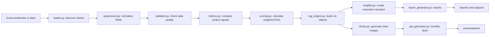

# Project Health Reporting Agent

The Project Health Reporting Agent is a Python-based AI reporting system for messy Excel project plans. It reads project workbooks, discovers useful sheets automatically, validates data quality, computes an independent Red/Amber/Green health score, compares that score with the workbook-entered status, and generates weekly reports plus a monthly executive PowerPoint.

The project was built for the Zycus technical assignment: leadership needs visibility into project health without manually chasing project managers every week.

## What This Project Solves

Project plan exports are often inconsistent. Different files may have different sheet names, missing columns, blank dates, partial owner data, comments in separate tabs, or project-manager-entered health colors that do not fully match task-level evidence.

This agent handles that by:

- Reading multiple Excel workbooks from `data/`.
- Detecting task, summary, and comment sheets automatically.
- Mapping inconsistent columns into one canonical schema.
- Validating missing or weak data without crashing.
- Computing project health independently from task-level signals.
- Explaining the reasoning behind each RAG status in plain English.
- Producing portfolio-level weekly and monthly outputs.

## Key Outputs

After a successful run, the agent produces:

- One-page RAG methodology in `methodology.md`.
- Weekly portfolio report in Markdown, HTML, JSON, and TXT.
- Per-project weekly reports for each workbook.
- Portfolio health JSON in `outputs/portfolio_health.json`.
- Analytical charts in `outputs/charts/`.
- Monthly 7-slide executive PowerPoint in `presentations/monthly_portfolio_health.pptx`.
- Execution logs in `logs/`.
- Schedule reference commands in `config/schedule_reference.txt`.

## Quick Start

Create and activate a virtual environment:

```bash
python -m venv .venv
.venv\Scripts\activate
python -m pip install --upgrade pip
python -m pip install -r requirements.txt
```

Run the full agent:

```bash
python run.py --llm-provider mock
```

The `mock` provider is deterministic and does not require any API key.

## Run Modes

Full run:

```bash
python run.py
```

Weekly reports only:

```bash
python run.py --weekly
```

Monthly synthesis or PowerPoint:

```bash
python run.py --monthly
python run.py --ppt
```

JSON or HTML outputs:

```bash
python run.py --json
python run.py --html
```

Override source folder, date, or LLM provider:

```bash
python run.py --data-dir data --as-of 2026-07-02 --llm-provider mock
```

Supported LLM providers are:

- `mock`: deterministic fallback, no credentials needed.
- `openai`: uses `OPENAI_API_KEY`.
- `groq`: uses `GROQ_API_KEY`.
- `ollama`: uses a local Ollama service.

The agent always works without external LLM credentials because the core scoring and reporting logic is deterministic.

## Folder Structure

```text
project-health-agent/
  config/
    default_config.json          RAG weights, thresholds, and runtime settings
    schedule_reference.txt       Suggested weekly and monthly automation commands

  data/
    S2P Project.xlsx             Source project workbook
    Project Plan B.xlsx          Source project workbook
    nw.pdf                       Assignment brief

  docs/screenshots/
    README.md                    Suggested screenshots for submission

  logs/
    agent_run.log                Detailed execution log
    sample_execution.log         Reviewer-friendly sample log

  outputs/
    portfolio_health.json        Full project and portfolio evaluation payload
    execution_summary.txt        Plain-text portfolio summary
    charts/                      Generated chart PNGs

  presentations/
    monthly_portfolio_health.pptx

  reports/
    weekly_report.*              Portfolio-level weekly reports
    weekly_<project_slug>.*      Per-project weekly reports

  src/
    cli.py                       CLI entry point and run orchestration
    config.py                    Settings, weights, thresholds, directories
    loader.py                    Workbook and sheet discovery
    preprocess.py                Canonical project dataset creation
    validator.py                 Data quality validation
    metrics.py                   Task-level metrics and signals
    scoring.py                   Weighted RAG scoring model
    rag_engine.py                End-to-end project and portfolio evaluation
    insights.py                  Executive narratives and recommendations
    charts.py                    Portfolio chart generation
    report_generator.py          Markdown, HTML, JSON, and TXT reports
    ppt_generator.py             Monthly executive PowerPoint
    scheduler.py                 Weekly/monthly schedule reference
    llm_reasoning.py             Optional LLM adapter with deterministic fallback

  tests/
    test_loader.py
    test_scoring.py
    test_validator.py
    test_report_generator.py
```

## High-Level Architecture

The system is intentionally built as a pipeline. Each stage has one responsibility and passes a clean object to the next stage.



## End-to-End Execution Flow

When you run `python run.py`, this is what happens internally:

1. `run.py` calls `src.cli.main()`.
2. `cli.py` loads settings from `config/default_config.json`.
3. Required output folders are created if they do not already exist.
4. `scheduler.py` writes the human-readable schedule reference file.
5. `rag_engine.py` starts the workbook evaluation process.
6. `loader.py` scans the `data/` folder for `.xlsx` and `.xlsm` workbooks.
7. Each workbook is read with `pandas` and `openpyxl`.
8. Each sheet is profiled to determine whether it is a task sheet, summary sheet, or comment sheet.
9. `preprocess.py` maps workbook-specific columns into canonical fields such as `task_name`, `status`, `percent_complete`, `start_date`, `end_date`, `schedule_health`, `rag`, `critical`, `total_float`, `assigned_to`, and `comments`.
10. `validator.py` checks whether required fields are present and whether important values are missing or invalid.
11. `metrics.py` computes task-level signals such as overdue work, completion percent, due-soon tasks, Red/Amber task signals, incomplete critical tasks, zero-float tasks, blocker comments, and owner gaps.
12. `scoring.py` converts those signals into a weighted project health score.
13. `rag_engine.py` combines all project results into a portfolio-level object.
14. `insights.py` writes executive summaries, risks, blockers, trends, and recommendations.
15. `charts.py` creates visual assets from the computed metrics.
16. `report_generator.py` writes Markdown, HTML, JSON, and TXT reports.
17. `ppt_generator.py` creates the monthly executive PowerPoint.
18. Logs are written to `logs/`.

## Module-by-Module Architecture

### `run.py`

This is the repository entry point. It is intentionally tiny:

```python
from src.cli import main
```

The file keeps command execution simple for reviewers:

```bash
python run.py
```

### `src/cli.py`

This module owns the command-line interface. It accepts options such as `--weekly`, `--monthly`, `--ppt`, `--json`, `--html`, `--data-dir`, `--as-of`, and `--llm-provider`.

Its central function is `run_agent()`. That function coordinates the full workflow:

- Load settings.
- Configure logging.
- Evaluate workbooks.
- Generate charts.
- Generate reports.
- Generate PowerPoint.
- Print a completion summary.

### `src/config.py`

This module loads runtime configuration. The most important configuration file is:

```text
config/default_config.json
```

That file defines scoring weights:

```json
{
  "schedule": 0.30,
  "budget": 0.20,
  "milestones": 0.20,
  "risks": 0.10,
  "blockers": 0.10,
  "sentiment": 0.05,
  "data_quality": 0.05
}
```

It also defines RAG thresholds:

- `GREEN`: score >= 85
- `AMBER`: score >= 60 and < 85
- `RED`: score < 60

### `src/loader.py`

This module is responsible for discovering and reading Excel workbooks.

It does not assume fixed sheet names. Instead, it profiles every sheet using evidence such as:

- Presence of task-like columns.
- Presence of summary labels.
- Presence of comment-like rows.
- Row counts and column names.

For example, a sheet with `Task Name`, `Status`, `% Complete`, `Start Date`, and `End Date` receives a high task score. A compact sheet containing labels such as `Project Manager`, `Project Stage`, and `Schedule Health` receives a high summary score.

This makes the agent more robust when project plans are exported in slightly different formats.

### `src/preprocess.py`

This module converts messy workbook data into a clean internal project dataset.

It uses a canonical column map. For example:

- `Task Name`, `Task`, or `Activity` becomes `task_name`.
- `% Complete`, `Percent Complete`, or `Completion` becomes `percent_complete`.
- `Owner`, `Assigned To`, or `Ownership` becomes ownership-related fields.
- `Yellow` is normalized to `AMBER`.

This module also:

- Parses dates.
- Parses duration and float values.
- Infers completion when `% Complete` is blank.
- Extracts comments from comment sheets and inline task comments.
- Pulls project metadata from the summary sheet.
- Uses workbook `Today's Date` when present so reports are reproducible.

### `src/validator.py`

This module checks data quality. It does not stop the run for every issue. Instead, it records problems and reduces the data quality score.

Required fields include:

- `task_name`
- `status`
- `percent_complete`
- `start_date`
- `end_date`

Important optional fields include:

- `schedule_health`
- `rag`
- `critical`
- `total_float`
- `variance`
- `assigned_to`
- `comments`
- `phase`

Validation findings are included in project reports so reviewers can see where confidence is strong or weak.

### `src/metrics.py`

This module calculates the project signals used by the scoring model.

Examples of computed metrics:

- Total tasks.
- Active tasks.
- Average completion percent.
- Expected completion percent based on elapsed time.
- Schedule gap.
- Overdue incomplete tasks.
- Tasks due in the next lookahead window.
- Red and Amber task-level signals.
- Critical tasks and incomplete critical tasks.
- Zero or negative float tasks.
- On-hold tasks.
- Blocker-like comments.
- Missing owner count.

This is the evidence layer of the system.

### `src/scoring.py`

This module converts metrics into a weighted health score.

The final score is:

```text
Final Score =
  Schedule Health * 0.30 +
  Budget Burn * 0.20 +
  Milestone Health * 0.20 +
  Risks * 0.10 +
  Blockers * 0.10 +
  Stakeholder Sentiment * 0.05 +
  Data Quality * 0.05
```

The agent does not simply trust the workbook-entered `Schedule Health` or `RAG`. Those fields are used as comparison signals. The computed RAG is generated independently from task-level evidence.

### `src/rag_engine.py`

This is the main evaluation orchestrator. It connects:

- Workbook loading.
- Dataset preprocessing.
- Validation.
- Metric calculation.
- RAG scoring.
- Portfolio aggregation.

It returns structured dataclasses such as `ProjectRun` and `PortfolioRun`, which are reused by reports, charts, JSON, and PowerPoint generation.

### `src/insights.py`

This module turns numeric results into business-readable language.

It creates:

- Executive summaries.
- Major risks.
- Recommendations.
- Top blockers.
- Resource constraints.
- Emerging trends.

This is where the output becomes useful for leadership, not just technically correct.

### `src/charts.py`

This module generates PNG charts using Matplotlib.

Charts include:

- Portfolio health mix.
- Project health score comparison.
- Planned vs actual completion trend.
- Risk heatmap.
- Completion vs expected progress.
- Task health signal mix by project.

The generated chart files are saved under:

```text
outputs/charts/
```

### `src/report_generator.py`

This module writes weekly reports in multiple formats:

- Markdown
- HTML
- JSON
- TXT

It creates both a portfolio-level report and per-project reports. The JSON output is especially useful because it preserves the full structured evaluation payload.

### `src/ppt_generator.py`

This module creates the monthly executive PowerPoint.

The generated deck has 7 slides:

1. Title and portfolio status.
2. Portfolio health overview.
3. Project comparison.
4. Emerging risks.
5. Recommendations.
6. Evidence charts.
7. Next steps.

The file is saved at:

```text
presentations/monthly_portfolio_health.pptx
```

### `src/scheduler.py`

This module writes portable schedule recommendations to:

```text
config/schedule_reference.txt
```

The weekly schedule command is:

```bash
python E:\Zycus\run.py --weekly --json --html
```

The monthly schedule command is:

```bash
python E:\Zycus\run.py --monthly --ppt
```

These are reference commands that can be translated into Windows Task Scheduler, cron, GitHub Actions, or another scheduler.

### `src/llm_reasoning.py`

This module provides optional LLM integration.

The project does not depend on an external LLM. In `mock` mode, all outputs are deterministic. If a provider such as OpenAI, Groq, or Ollama is configured, the adapter can call it for enhanced reasoning text. If credentials are missing or the call fails, the deterministic fallback is used.

## RAG Methodology

The scoring methodology is documented in more detail in `methodology.md`. At a high level:

- Schedule looks at progress vs expected elapsed progress, overdue tasks, Red signals, and zero-float work.
- Budget is neutral with low confidence when budget fields are missing.
- Milestone health looks at due-soon work, critical tasks, and schedule gap.
- Risks penalize Red/Amber signals, incomplete critical tasks, and on-hold tasks.
- Blockers come from blocker-like comment language, on-hold tasks, and zero-float work.
- Sentiment uses deterministic keyword analysis.
- Data quality penalizes missing columns, invalid dates, inferred completion values, and unknown statuses.

## Current Sample Result

With the supplied workbooks, the latest run evaluates:

- `Zycus - UniSan S2P Implementation`: `RED`, score `57.0`
- `Zycus - Titan S2P Implementation`: `AMBER`, score `61.9`
- Overall portfolio: `RED`, score `59.4`

The Titan workbook reports `GREEN`, but the agent computes `AMBER` because task-level evidence shows overdue work, Red/Amber task signals, incomplete critical tasks, and blocker-like comments. This discrepancy is intentionally highlighted in the reports.

## Design Decisions

- The agent computes health independently instead of copying workbook status.
- Workbook-entered health is used only for comparison and discrepancy analysis.
- Missing budget data reduces confidence but does not invent a financial conclusion.
- Messy or incomplete data is reported through validation findings instead of stopping execution.
- Column mapping uses aliases so the code can handle similar workbook exports.
- All major outputs are generated from the same `PortfolioRun` object, keeping report, JSON, chart, and PowerPoint numbers consistent.
- `mock` mode makes the project reproducible without API keys.

## Generated Output Locations

Portfolio weekly report:

```text
reports/weekly_report.md
reports/weekly_report.html
reports/weekly_report.json
reports/weekly_report.txt
```

Per-project reports:

```text
reports/weekly_zycus-unisan-s2p-implementation.*
reports/weekly_zycus-titan-s2p-implementation.*
```

Portfolio JSON:

```text
outputs/portfolio_health.json
```

Charts:

```text
outputs/charts/
```

Monthly deck:

```text
presentations/monthly_portfolio_health.pptx
```

Logs:

```text
logs/sample_execution.log
logs/agent_run.log
```

## Testing

Run the test suite:

```bash
python -m pytest
```

The tests cover:

- Sheet discovery logic.
- RAG threshold mapping.
- Validation behavior for missing fields.
- Plain-text report formatting.

## Screenshot Guidance

The screenshot inventory is in:

```text
docs/screenshots/README.md
```

It lists the key report and deck views that can be captured for a GitHub or ZIP submission.

## Future Improvements

- Add budget-burn scoring when project exports include budget, spend, cost, or burn-rate fields.
- Add dependency graph analysis when predecessor fields are consistently maintained.
- Persist historical runs to support real trend analysis over time.
- Add a web dashboard for interactive portfolio exploration.
- Add stronger natural-language comment classification using an LLM when credentials are available.
