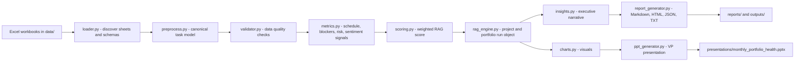

# Architecture

The agent is organized as a small production-style pipeline. Each module has one clear responsibility, and generated reports are based on normalized task-level evidence rather than workbook summary status alone.

## Design Decisions

- Workbook sheets are profiled automatically using column evidence, row counts, and compact key/value patterns.
- Canonical fields are mapped through aliases, so variants such as `RAG`, `Schedule Health`, `% Complete`, and `Critical ?` can be handled without fixed column positions.
- Missing columns are reported as data quality findings instead of causing runtime failure.
- LLM reasoning is optional. OpenAI, Groq, and Ollama are supported through a small adapter, while mock mode always produces deterministic reasoning.
- Reports and the PowerPoint are regenerated from the same evaluation object to keep numbers consistent across all outputs.
